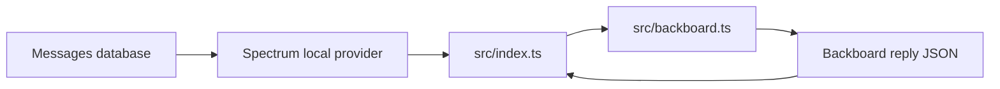
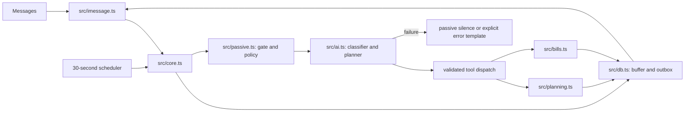
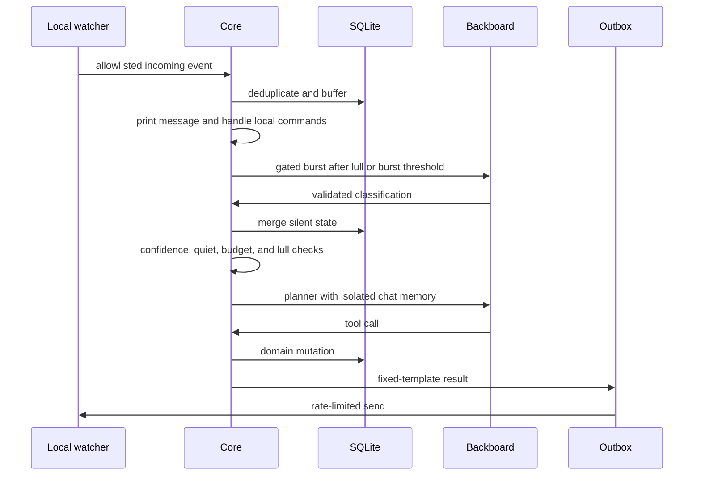

# Mi Amigo core implementation

## Outcome
Implement Project_Idea.md sections 1–9, plus incoming-message console output, without the section 10 stretch features.

## Scope
The core includes local ingestion and retention, passive classification, silent plan state, explicit commands, text polls, locking, local bill arithmetic, payment tracking, reminders, Backboard tools and isolated memory.
Mac account setup and actual group participation require the user's existing logged-in Messages session.
Do not send verification messages to contacts without a selected test destination.

## Current Architecture
The current src/index.ts uses Spectrum's local provider and sends every allowlisted incoming text to src/backboard.ts.
The adapter asks for a free-form reply decision and persists thread IDs, but has no plans, bills, commands, timers, or local gate.
The installed imessage-kit exposes group messages, reactions, participant lists, AppleScript sends, and outbound-delivery callbacks.

## Proposed Architecture
Replace the old listener and adapter, not their public behavior through compatibility wrappers.
Use the direct imessage-kit dependency to obtain participants and tapbacks.
Parent owns integration, common contracts, the database core, config, passive orchestration, local I/O, and docs.
Independent bounded owners implement planning, billing, and Backboard integration against src/contracts.ts.

## Runtime Flow

## Implementation Steps
1. Define shared event, context, classification, domain action, and emission contracts.
2. Implement independent planning, billing, and Backboard modules.
3. Implement ingestion, privacy boundaries, persistence, passive policy, commands, scheduler, and durable outbox.
4. Migrate runtime dependencies and existing environment names without exposing credentials.
5. Run deterministic suites, synthetic end-to-end scenarios, native watcher startup, and real Backboard checks.
6. Reconcile the full contract with an independent reviewer and document operation.

## Risks and Tradeoffs
Backboard memory belongs to an assistant, so each group receives its own planner assistant rather than sharing private memories.
The classifier uses memory off and short-lived threads.
Eight new messages may trigger classification, but proactive speech still waits for the lull.
Auto-lock follows the specified ten-minute objection window only after a concrete proposal, with cancellation on objections.
No-op user consent is not inferred for payments or external actions.
Shares include the payer's consumed share, but the payer has no debt to themselves.
Use floor division plus deterministic remainder allocation, not rounded equal shares that can exceed the bill.
Reminders and messages are durable, but an uncertain AppleScript delivery is never blindly retried.
The legacy free-form adapter is removed after cutover.

## Open Questions
No product-scope question remains: the user selected the full core specification.
Native outbound verification requires another group participant and AppleScript permission; synthetic scenarios do not substitute for that external check.

## Verification
Cover classification schema failures, banter costs, bursts and lull boundaries, quiet/back-off budgets, isolation, restart persistence, poll voting, natural availability, plan locking and reopening, cents and adjustments, paid authorization, tapback targeting, two-nudge limits, retention, rate limits, and remote forgetting.
Run the actual application startup without sending to real contacts.
Exercise real Backboard with synthetic content and report provider unavailability without treating it as application success.
Use a cold reviewer and a promise ledger before delivery.
